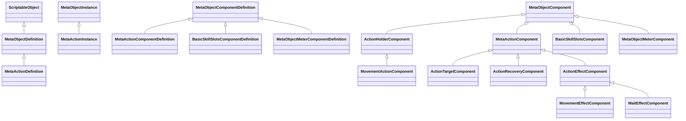
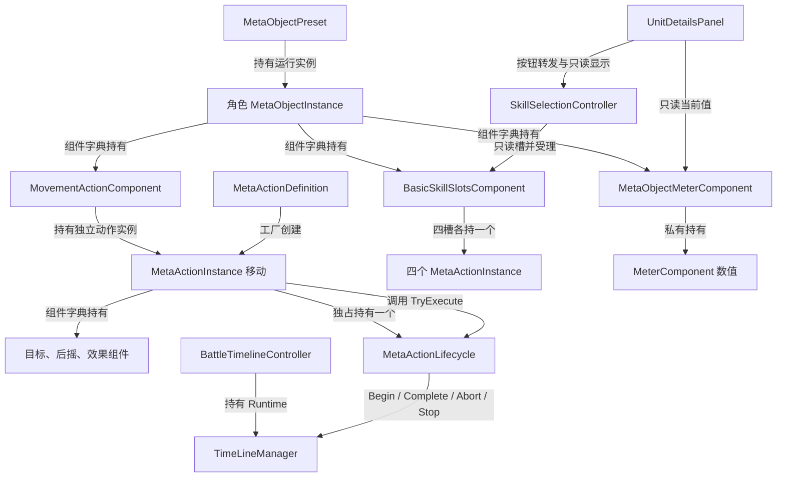

# 程序集与类型关系总览代码设计案

当前对象、动作、技能槽、移动、时间轴、属性与详情 UI 的相关代码共同编入 Assembly-CSharp。理解这一实现需要分清三层结构：程序集包含类，类声明方法；类之间再通过继承、组合持有或调用协作。目录上的 MetaObjects、Battle、Player 和 UI 只是组织源码，不能据此理解成多个程序集或几套独立对象体系。

| 项目 | 内容 |
| --- | --- |
| 解释范围 | 对象底座、对象侧组件（含技能槽与量表）、动作派生、生命周期、时间轴、移动、属性与详情 UI 相关的 31 份脚本、67 个类/接口/结构体/枚举声明及其主要结构关系；不覆盖工程全部类型 |
| 源码依据 | Assembly-CSharp.csproj、Assembly-CSharp-Editor.csproj、Assembly-CSharp-firstpass.csproj，以及各专题所列类型声明 |
| 核对基线 | 工程 7362b95addd908be4f96110c2c51ad0300af8e58；2026-10-27；量表组件、三份角色定义与界面改动已由该提交收录，相关文件无未提交差异 |
| 关联设计 | [架构设计案 §2、§5、§7.12](../架构设计文档/架构设计案.md)；架构模块是职责约束，实际程序集以工程为准 |
| 状态 | 已核对：结构、源码及静态配置；不含本轮编译或运行验证 |
| 更新日期 | 2026-10-27 |

## 程序集归属与引用

| 程序集 | 当前工程依据及范围 | 与本库相关的引用方向 |
| --- | --- | --- |
| Assembly-CSharp | [同名工程](D:/myspace/Git/mygame/Assembly-CSharp.csproj) 的 AssemblyName 和 Compile 项包含本库全部 31 份脚本，包含 UnitDetailsPanel、技能槽组件与量表组件；这些类未声明 namespace，处于全局命名空间 | 使用 UnityEngine、Tilemap、uGUI 和 Unity.TextMeshPro 等程序集；ProjectReference 包含 Assembly-CSharp-firstpass、MCPForUnity.Editor、MCPForUnity.Runtime |
| Assembly-CSharp-Editor | [同名工程](D:/myspace/Git/mygame/Assembly-CSharp-Editor.csproj)，承接 Assets/Editor 下的编辑器脚本；不作为本库运行类型的声明归属 | 引用 Assembly-CSharp、Assembly-CSharp-firstpass 及 MCPForUnity.Editor/Runtime；编辑器验证代码调用运行类型，不改变运行类型归属 |
| Assembly-CSharp-firstpass | [同名工程](D:/myspace/Git/mygame/Assembly-CSharp-firstpass.csproj)，承接工程中先行编译的插件代码 | 被前两者引用；当前生成工程也列有 MCPForUnity.Editor/Runtime 引用 |

以上是当前生成工程文件中的事实，不是新增分层方案。插件中的 Editor 引用需要与具体构建目标和生成条件一起验证，不能仅据这些工程文件认定播放器可构建。本库没有把 Assembly-CSharp 内的普通 C# 类和 MonoBehaviour 分成独立领域程序集，也没有把空 RootNamespace 当作类声明了某个默认 namespace。

## 对象与动作的继承骨架

这里的空心三角表示继承。MetaActionDefinition 和 MetaActionInstance 是通用对象体系的派生类型；动作侧组件同样继承通用组件底座。MovementActionComponent 属于角色对象侧，它持有一个动作，但自身并不继承 MetaActionComponent；BasicSkillSlotsComponent 同为对象侧组件，与它并列而不是它的派生。MetaObjectMeterComponent 也是对象侧组件，内部组合原有的 MeterComponent，后者不继承 MetaObjectComponent。具体声明和关键方法归属分别见[对象底座](10_MetaObject类型与组件底座代码设计案.md)、[对象侧组件](20_对象组件与场景承载类型代码设计案.md)、[动作体系](30_MetaAction派生类型与动作组件代码设计案.md)、[技能槽](80_基础技能槽与待机动作代码设计案.md)与[量表](75_量表组件与生命显示代码设计案.md)。

## 持有、创建与调度地位

图中的箭头是已标明含义的组合、创建和调用，不能读成继承。对象定义资产保存组件配置，CreateInstance 创建运行组件；动作定义通过重写工厂创建动作实例。每个动作实例独占生命周期执行器，后者统一承接该次动作从开始、生效到完成或终止的执行次序。技能槽保存共享的动作定义与按角色独占的动作实例；量表保存运行期数值，显示方不持有副本；场景选择适配器只保存意图，真正的受理仍进入槽组件与动作实例。

MetaActionInstance.TryExecute 是动作对外受理入口，负责定义、目标和行动资格校验；MetaActionLifecycle.TryExecute 是动作内部统一生效与结束交接入口；TimeLineManager.BeginAction/CompleteAction 等方法是行动机会与标记的交接边界。三者分别回答“请求能否受理”“该次行为如何执行并结束”“下一次轮到谁”。各自持有状态和作用域不同，详见[生命周期执行器](40_MetaActionLifecycle统一执行入口代码设计案.md)与[时间轴](50_TimeLineManager与战斗装配类型代码设计案.md)。

## 方法归属的阅读方式

调用方持有或调用某个方法，不会改变它的声明类。MetaActionDefinition 使用的 CreateInstance 声明在 MetaObjectDefinition，派生类只重写 CreateRuntime；MovementActionComponent 使用的 TryExecute 声明在 ActionHolderComponent，BasicSkillSlotsComponent 的同名受理方法声明在槽组件自身；MetaActionInstance 从 MetaObjectInstance 继承 AddComponent/GetComponent，并重写 Dispose。各专题的方法表标明声明类或重写来源，避免把业务功能名当作真实成员。

场景承载和移动适配器使用 MonoBehaviour，普通对象、运行组件、生命周期执行器、时间轴逻辑、技能槽与量表是普通 C# 类型。它们目前处于同一程序集内，故这里描述的是实际类协作，不能据此宣称已具备架构要求的所有模块隔离与公共服务。

## 界面选择与执行入口的关系

UnitDetailsPanel : MonoBehaviour 也声明在 Assembly-CSharp 全局命名空间，引用时间轴控制器、当前所选移动控制器，持有详情、提示、生命摘要、移动按钮、四个技能按钮及其标签的场景引用。它不是 MetaObjectComponent，也不持有动作实例、行动标记或角色生命。GameManager 绑定时间轴；移动按钮通过 CharacterMovementController.SelectMovement 进入移动选择；技能按钮通过 SelectSkill 转发给由战斗装配动态添加的 SkillSelectionController，再由槽组件进入动作受理链。生命摘要直接读取角色量表的当前值与上限，不参与选择或执行。

取消通过控制器与技能适配器清理指针、覆盖层、范围缓存和选择记录，不调用动作生命周期或回排；只有确认后的动作才进入受理。界面类、方法与静态绑定见[单位详情面板](70_UnitDetailsPanel与移动选择界面代码设计案.md)。
