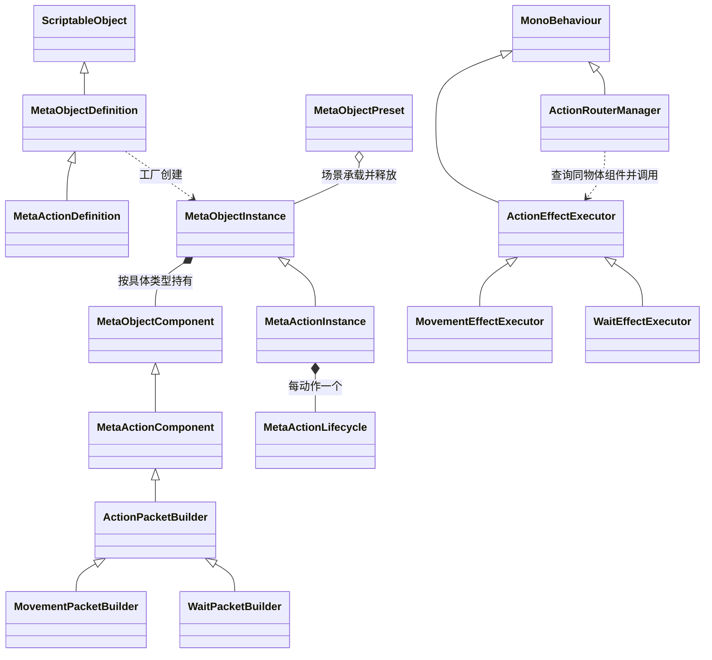

# 程序集与类型关系总览代码设计案

这些类型共同提供角色运行数据、地图选格、动作报文执行、时间轴调度与底部操作界面。角色和动作都由静态定义创建独立运行实例；场景适配器连接输入与表现；动作构造器生成键值报文，槽位补齐上下文后交给场景中的共享执行器。

| 项目 | 内容 |
| --- | --- |
| 解释范围 | Assembly-CSharp，全局命名空间；元对象、元动作、场景适配、时间轴、报文与界面的归属及协作关系 |
| 源码依据 | Assembly-CSharp.csproj 的 Compile/Reference；MetaObjectDefinition.CreateInstance；ActionPacketOutlet.Send；ActionRouterManager.Send；文件入口见文末实现定位 |
| 核对基线 | 工程提交 `65c2ff5e40cec060988b74091e189e09fdaa9e13`；2026-10-29 核对时工程工作区干净 |
| 关联设计 | [架构设计案 §2、§5、§7.12](../架构设计文档/架构设计案.md)；架构模块是职责约束，实际程序集以工程为准 |
| 状态 | 已核对：源码声明、调用链与静态资产绑定 |
| 更新日期 | 2026-10-29 |

## 程序集与命名空间

工程的 `Assembly-CSharp.csproj` 将本目录专题覆盖的运行脚本列为 Compile 项，这些脚本均使用全局命名空间。`Assets/Script/Battle`、`MetaObjects`、`Player`、`UI` 是源码目录，类型的程序集归属由工程文件确定。

| 程序集或引用 | 在解释范围中的作用 |
| --- | --- |
| Assembly-CSharp | 元对象、动作、Router、时间轴、地图、选择适配器和面板的运行代码 |
| UnityEngine 及 Tilemap 模块 | MonoBehaviour、场景承载、Grid 与覆盖层 |
| UnityEngine.UI、Unity.TextMeshPro | 底部按钮、图像、文字与界面射线检测 |
| Newtonsoft.Json | Router 将请求和结果记录写为 JSONL |
| Cinemachine | 当前行动者的相机跟随与位置缓动 |
| Assembly-CSharp-Editor | `Assets/Editor` 中的编辑期工具；运行功能依据取自实际调用链 |

## 继承、创建与组合

图中的继承箭头表示直接基类，实心菱形表示运行对象持有，虚线表示工厂或调用。组件定义通过 `CreateComponent` 创建组件；该关系与类型继承分别成立。

角色运行实例按具体组件类型保存坐标、纹理、属性、朝向、量表、移动动作容器和基础技能槽。移动容器持有一个动作实例，四槽容器按槽持有四个动作实例。每个动作实例的组件构成为一个 `ActionPacketBuilder` 派生对象，目标指向性与后摇配置随该构造器保存。

`ActionRouter` GameObject 同时挂载 `ActionRouterManager`、`MovementEffectExecutor`、`WaitEffectExecutor`。Manager 按 operation 查找同物体上启用的执行组件，作用域覆盖向它发送的请求；每种操作需要唯一匹配。元对象内部消息则限定在各自 Owner 内。

## 入口与职责交接

| 声明入口 | 持有者、调用方与作用域 |
| --- | --- |
| MetaObjectDefinition.CreateInstance | 定义工厂，创建运行对象并逐项挂组件；MetaActionDefinition 重写 CreateRuntime 创建动作实例 |
| MetaObjectInstance.AddComponent / Dispose | 单个元对象的组件归属与清理；组件回调由底座触发 |
| MovementActionComponent 继承的 TryExecute / BasicSkillSlotsComponent.TryExecute | 角色侧发送入口，核对 Owner 并选择动作，调用共享 ActionPacketOutlet.Send |
| ActionPacketOutlet.Send | 静态发送辅助，调用构造器、补齐来源和目标、登记来源，再经动作生命周期发送 |
| MetaActionInstance.ExecutePacket / MetaActionLifecycle.TryExecute | 每动作实例的机会检查、时间轴执行锁与结束处理 |
| ActionRouterManager.Send | 场景共享分发入口，生成快照、解析操作、调用执行器、记录结果 |
| TimeLineManager.BeginAction / CompleteAction / AbortAction | 权威时间轴的开始、成功回排和拒绝解锁步骤，由动作生命周期调用 |
| BattleTimelineController.TryStartBattle | 场景装配入口，将参战配置、角色、Router 与选择控制器接线 |
| UnitDetailsPanel.BindTimeline / Refresh | 读取当前行动者、槽位和生命摘要，并将按钮选择转发给场景适配器 |

## 从输入到状态变化

玩家先选择移动或技能槽。场景适配器记录机会编号与角色实例，确认时将角色、目标格、移动能力、时间轴和 Router 装入执行上下文。槽位调用构造器得到技能参数，补齐报文并进入动作生命周期。时间轴先准备回排时刻并加锁；Router 同步分发报文，执行器形成效果结果；成功后生命周期完成回排，适配器清理选择。

地图范围与 UI 是查询和派生显示。移动状态落在 `SceneCoordinateComponent`，属性落在 `AttributeComponent`，动态量表落在 `MetaObjectMeterComponent`。Router 的来源登记将报文中的运行 ID 解析为本局实例；日志保存基础值快照。

专题的主要结构说明分别位于 [10 对象底座](10_MetaObject类型与组件底座代码设计案.md)、[20 场景承载](20_对象组件与场景承载类型代码设计案.md)、[30 动作构造](30_MetaAction派生类型与动作组件代码设计案.md)、[40 生命周期](40_MetaActionLifecycle统一执行入口代码设计案.md)、[50 时间轴](50_TimeLineManager与战斗装配类型代码设计案.md)、[60 移动](60_地图与移动适配类型代码设计案.md)、[70 面板](70_UnitDetailsPanel与移动选择界面代码设计案.md)、[75 量表](75_量表组件与生命显示代码设计案.md)、[80 技能槽](80_基础技能槽与待机动作代码设计案.md) 和 [90 报文路由](90_ActionRouterManager与键值报文执行代码设计案.md)。

## 架构约束与源码范围

设计背景与运行实现分别提供约束依据和事实依据。下表按当前结构定位二者关系。

| 设计背景 | 当前源码事实 | 说明范围 |
| --- | --- | --- |
| 架构设计案 §2.1.2 按层次划分程序集 | 本专题运行类型由 Assembly-CSharp 编译，引用 Unity 与表现包 | 类型职责及实际依赖以工程文件和声明为准 |
| 架构设计案 §7.11、§8.3 要求跨单元引用来自装配 | 战斗 Controller 显式引用 Router；发送出口在上下文 Router 缺失时读取静态 ActionRouterManager.Instance | 静态回退路径是与装配约束的实现差异，约束对照与调用行为分别记录 |
| 元动作设计的即时效果寿命及持续影响管理 | 槽位持有可重复执行的动作、构造器和生命周期，移动与待机使用场景共享执行器 | 一次性即时效果实例和元持续效果管理属于未实现能力 |
| 架构设计案 §7.7 描述公共日志基础设施 | Router 保存动作请求和执行器结果，按自身配置追加 JSONL | 本文日志范围是动作路由记录，公共日志服务另按实际实现核验 |

## 实现定位

| 源码或资产 | 主要定位 |
| --- | --- |
| [Assembly-CSharp.csproj](D:/myspace/Git/mygame/Assembly-CSharp.csproj) | 运行脚本与 Unity、UI、Newtonsoft.Json、Cinemachine 引用 |
| [Assembly-CSharp-Editor.csproj](D:/myspace/Git/mygame/Assembly-CSharp-Editor.csproj) | 编辑期程序集归属 |
| [MetaObjectDefinition.cs](D:/myspace/Git/mygame/Assets/Script/MetaObjects/MetaObjectDefinition.cs) | CreateInstance 与运行工厂 |
| [ActionPackets.cs](D:/myspace/Git/mygame/Assets/Script/Battle/ActionPackets.cs) | ActionPacketOutlet.Send |
| [ActionRouterManager.cs](D:/myspace/Git/mygame/Assets/Script/Battle/ActionRouterManager.cs) | Send 与执行器查找 |
| [PersistanceScene.unity](D:/myspace/Git/mygame/Assets/Scenes/PersistanceScene.unity) | 角色、时间轴和 ActionRouter 静态装配 |

核对依据为上述提交的源码、工程配置与静态资产。文档状态表示所述实现已完成对照；编译、播放、画面与交互的运行验证属于独立验证范围。
