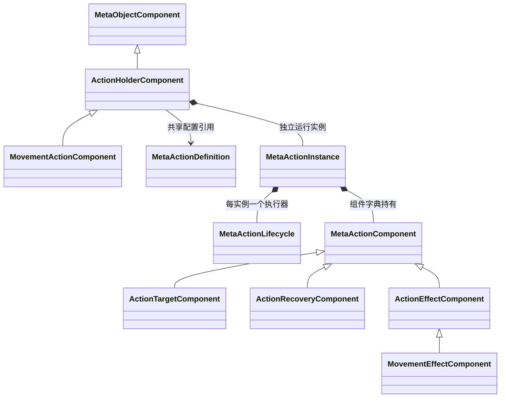

# MetaAction 派生类型与动作组件代码设计案

源码用 MetaAction 系列类型承载元动作（术语表 T-188）及当前移动技能。动作不是与元对象平行的孤立系统：动作定义和动作实例分别派生自对象定义和对象实例，组件也复用同一底座，并进一步分成角色对象侧的“持有动作”与动作内部的“目标、后摇和效果”。

| 项目 | 内容 |
| --- | --- |
| 解释范围 | Assembly-CSharp，全局命名空间；动作定义、实例、组件派生与配置、持有组件、执行上下文及能力接口 |
| 源码依据 | MetaActionDefinition、MetaActionInstance、MetaActionComponents、MovementActionComponent 的声明及调用 |
| 核对基线 | c744a32b59973f9888d69447bbd2775fccf064f4；2026-10-24；相关源码与动作资产无未提交差异 |
| 关联设计 | [元动作 §4.3、§4.4](../系统设计文档/01-通用系统/70-元动作/70_元动作设计补充说明.md) |
| 状态 | 已核对：类型关系、源码与静态配置 |
| 更新日期 | 2026-10-24 |

## 动作与对象的三组派生

| 声明类型 | 直接基类 | 结构职责 |
| --- | --- | --- |
| MetaActionDefinition | MetaObjectDefinition | 复用组件配置清单与 CreateInstance，重写 CreateRuntime 创建动作实例 |
| MetaActionInstance | MetaObjectInstance | 复用组合字典、精确类型查询和释放，增添动作受理与生命周期执行器 |
| MetaActionComponentDefinition | MetaObjectComponentDefinition | 动作侧配置抽象基类，将 IsActionComponent 密封重写为 true |
| MetaActionComponent | MetaObjectComponent | 动作内部运行组件的共同抽象基类，仍使用 Owner/生命周期机制 |

这里的“元技能”在当前代码中没有另一个 MetaSkill 基类。移动作为动作配置和效果体现，不能凭业务称谓另画一个源码中不存在的继承节点。MetaActionInstance 构造把 IsAction 设为 true，配合底座的侧别校验，禁止把对象侧组件挂进动作实例或反向混挂。

## 对象侧持有与动作内部组合

ActionHolderComponent 直接继承 MetaObjectComponent，是普通对象侧抽象类；MovementActionComponent 派生于它，本身只提供构造。MovementActionComponentDefinition 也直接继承 MetaObjectComponentDefinition，创建的是对象侧持有组件。这两者不是动作内部组件。角色对象持有 MovementActionComponent，后者引用共享动作定义并拥有独立动作运行实例。

ActionHolderComponent.OnAttached 创建动作；OnUnbind/OnDetached 终止并清空，OnBind 在缺失时重建。Prepare 仅在仍挂载、当前动作已 Terminated 且有定义时重建，战斗启动调用它。多个角色可以共享定义资产，但动作实例与其阶段各自独立。

| 动作内部运行类 | 直接基类 | 配对配置类及其直接基类 |
| --- | --- | --- |
| ActionTargetComponent | MetaActionComponent | ActionTargetComponentDefinition : MetaActionComponentDefinition |
| ActionRecoveryComponent | MetaActionComponent | ActionRecoveryComponentDefinition : MetaActionComponentDefinition |
| ActionEffectComponent | MetaActionComponent，抽象类 | 只有效果共同协议，没有单独的具体配对配置 |
| MovementEffectComponent | ActionEffectComponent | MovementEffectComponentDefinition : MetaActionComponentDefinition |

各配置类重写 CreateComponent，返回相应运行组件。运行组件由 MetaActionInstance 继承来的字典持有；配置对象属于定义清单。ActionRecoveryComponent 保存 BattleBehaviorDefinition 资产引用并读取 Recovery，尚未把它当成可变动作状态。

## 上下文、接口和数据类型

ActionExecutionContext 是普通 sealed class，保存角色运行实例、机会编号、目的格、IMovementCapability 与可选 TimeLineManager 引用，供一次受理使用；它不创建或拥有这些角色和时间轴。IMovementCapability 是接口，声明有效性、目标查询、校验和实际移动，具体实现为 CharacterMovementController 的私有嵌套类 MovementCapability，详见[移动适配](60_地图与移动适配类型代码设计案.md)。

ActionResult 枚举表示 Succeeded、NoChange、NotReady、InvalidTarget、OutOfRange、OutOfTurn、Rejected 等受理结果，ActionTargetKind 枚举目前只有 Cell。CapabilityId 是从效果组件推得的 Movement 字符串，不是单独的完整技能分类系统。

## 关键方法归属与入口

| 关键成员的实际声明类 | 继承/重写及主要调用关系 | 当前作用 |
| --- | --- | --- |
| MetaObjectDefinition.CreateInstance | MetaActionDefinition 继承，内部虚调用后者 CreateRuntime | 统一创建配置组件；不能误记为动作定义重新声明 |
| MetaActionDefinition.CreateRuntime | 重写对象定义基类 | 返回 MetaActionInstance |
| ActionHolderComponent.TryExecute | MovementActionComponent 继承；移动控制器调用 → Action.TryExecute | 检查上下文角色确为持有方 Owner，再交动作 |
| MetaActionInstance.ValidateDefinition | 控制器、查询与执行路径调用 | 要求目标、后摇和唯一效果组件，检查后摇合法 |
| MetaActionInstance.TryQueryTargets | 控制器 → 目标组件 Query → 能力接口 | 返回当前目标集合和版本 |
| MetaActionInstance.TryExecute | 持有方 → 目标 Validate → lifecycle.TryExecute | 动作对外统一受理，先验证定义、能力、当前角色与机会 |
| ActionTargetComponent.Validate / Query | 动作实例 → IMovementCapability | 只转交能力校验/查询，不读取鼠标或直接定位 |
| MovementEffectComponent.Apply | 重写 ActionEffectComponent.Apply；生效委托调用 → TryMove | 具体移动效果入口 |
| MetaActionInstance.Dispose | 重写 MetaObjectInstance.Dispose | 标记终止、调用生命周期 Terminate，再清理组件；Terminate 转到本重写入口 |

验证后的生效及结束交接由独占 MetaActionLifecycle.TryExecute 承担，其统一执行地位见[独立专题](40_MetaActionLifecycle统一执行入口代码设计案.md)。动作实例自身 Phase 从该执行器读取，受理前拒绝会调用生命周期 Reject；LastError 由动作实例保存受理错误或复制执行器结果。

## 当前资产与边界

MovementAction 定义配置地格目标、后摇组件和一个移动效果。后摇引用 MovementTiming，当前值为 10 游戏秒。三角色的持有组件引用同一动作资产。有效动作的直接目标/类别/后摇属性依赖组件存在，正常调用链先 ValidateDefinition；任意外部直接读取无效动作不保证安全。

当前仅有移动效果与 Cell 目标，未实现全部技能族、复杂目标、成本/产出串与其他行为接入。动作成功后仍由持有方保存并可重复执行，未建立设计所述“即时性效果实例生效后销毁”的独立一次性实例层。统一入口存在也不能证明全部角色行为已经接入。

## 实现定位

- [MetaActionDefinition.cs](D:/myspace/Git/mygame/Assets/Script/Battle/MetaActionDefinition.cs)：动作定义派生及工厂重写。
- [MetaActionInstance.cs](D:/myspace/Git/mygame/Assets/Script/Battle/MetaActionInstance.cs)：动作实例派生、受理、执行器持有和 Dispose 重写。
- [MetaActionComponents.cs](D:/myspace/Git/mygame/Assets/Script/Battle/MetaActionComponents.cs)：动作组件树、上下文、接口和结果枚举。
- [MovementActionComponent.cs](D:/myspace/Git/mygame/Assets/Script/MetaObjects/MovementActionComponent.cs)：对象侧持有组件及其配置、继承方法。
- [MovementAction.asset](D:/myspace/Git/mygame/Assets/GameData/Battle/MovementAction.asset)、[MovementTiming.asset](D:/myspace/Git/mygame/Assets/GameData/Battle/MovementTiming.asset)：当前动作组合与后摇引用。
