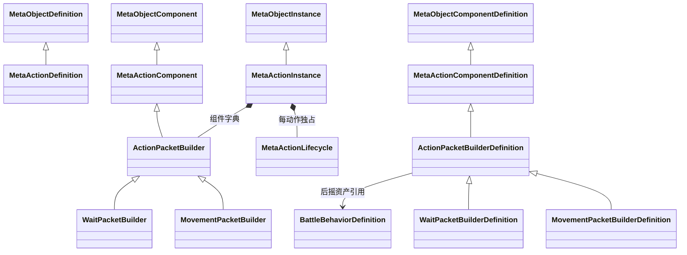

# MetaAction 派生类型与动作构造代码设计案

元动作使用定义资产创建独立动作实例。动作实例持有一个效果报文构造器和自己的执行生命周期；构造器保存技能参数并生成报文，角色侧槽位补齐来源与实际目标，场景 Router 调用共享执行器完成效果。移动与待机采用相同的构造和发送路径。

| 项目 | 内容 |
| --- | --- |
| 解释范围 | Assembly-CSharp，全局命名空间；MetaActionDefinition、MetaActionInstance、MetaActionComponent、ActionPacketBuilder 及移动/待机构造器、ActionExecutionContext 与 ActionResult |
| 源码依据 | MetaActionDefinition.CreateRuntime；MetaActionInstance.BuildPacket/TryQueryTargets/ExecutePacket；ActionPacketBuilder.Build；文件入口见文末实现定位 |
| 核对基线 | 工程提交 `bf1b4d8caf90a8d6e10de503f1e682b96bb3b936`；2026-10-30 核对源码与静态资产 |
| 关联设计 | [元动作 §4.3、§4.4](../系统设计文档/01-通用系统/70-元动作/70_元动作设计补充说明.md) |
| 状态 | 已核对：源码声明、调用链与静态资产绑定 |
| 更新日期 | 2026-10-30 |

## 派生关系与作用域

类型均属于 Assembly-CSharp，全局命名空间。MetaActionDefinition 继承并使用 MetaObjectDefinition.CreateInstance，重写 CreateRuntime 返回 MetaActionInstance，IsActionDefinition 为 true。MetaActionComponentDefinition 的 IsActionComponent 重写固定为 true，运行挂载由 AddComponent 按实际组件类型判断归属。

MetaActionInstance 是角色动作容器持有的普通 C# 实例；ActionPacketBuilder 是其中的普通 C# 组件。ActionEffectExecutor 则继承 MonoBehaviour，挂在 Router GameObject 上，其主要结构见 [90 Router 专题](90_ActionRouterManager与键值报文执行代码设计案.md)。每个角色每个槽持有自己的构造器和生命周期，场景内各操作按配置使用对应执行器。

## 技能参数与构造器

ActionPacketBuilderDefinition 保存 targetKind 与 timing 引用；创建时传给对应运行构造器。ActionPacketBuilder.Recovery 从 BattleBehaviorDefinition 读取 double 后摇，Build 生成 Ordinal 字符串键字典，包含 operation、targetKind 和 recovery。构造发生在确认执行后的发送阶段；界面查询与目标预览读取动作属性。

| 构造器 | operation | targetKind | 当前配置 |
| --- | --- | --- | --- |
| MovementPacketBuilder | Movement | Cell | MovementAction 引用 MovementTiming，后摇 10 游戏秒 |
| WaitPacketBuilder | Wait | None | WaitAction 引用 WaitTiming，后摇 10 游戏秒 |

目标配置与后摇配置属于构造器的技能参数，来源和实际目标由槽位补齐。构造器直接读取 timing.Recovery，并按配置的指向性生成报文。

## 动作实例的参数与目标查询

CapabilityId 读取构造器 Operation，TargetKind 与 Recovery 读取构造器参数；BuildPacket 直接调用构造器 Build。构造器通过组件字典中的 ActionPacketBuilder 类型筛选取得。

`TryQueryTargets` 面向地格动作，要求动作相态为 Terminated 以外的状态且指向性为 Cell，再调用 IMovementCapability.TryGetTargets。能力接口提供 IsValid、TryGetTargets、Validate；其场景实现由 CharacterMovementController 提供，负责目标查询与提交时的移动业务判定。位置写入发生在 MovementEffectExecutor。

## 上下文、发送与执行结果

ActionExecutionContext 是同步调用使用的普通对象，保存 Actor、OpportunityId、Destination、Movement、Timeline、Router 以及 Object 指向性的 Target 引用。槽位核对 Actor 为自身 Owner，将这些本局引用转换为报文的运行标识与基础值。上下文的场景引用留在调用层与 Router 的来源登记中。

移动容器继承的 TryExecute、基础技能槽的 TryExecute 都调用 ActionPacketOutlet.Send；发送出口调用 BuildPacket 并补齐上下文，再调用 MetaActionInstance.ExecutePacket。该内部入口通过 `ActionPacket.Get<double>` 读取 recovery，将发送委托交给自身生命周期。时间轴在 BeginAction 中判断当前机会。

生命周期仅将 ActionResult.Succeeded 视为效果成功。发送结果为 None（含委托尚未执行）或 Succeeded 时，动作入口使用 lifecycle.Result 表达最终受理和完成结果；其余执行器结果直接返回。LastError 从生命周期读取，字段和日志覆盖见 Router 专题。

| ActionResult | 当前语义 |
| --- | --- |
| None | 默认结果值 |
| Succeeded | 效果成功并由调用链确认完成 |
| NoChange | 目的格等于当前位置 |
| NotReady | 动作处于执行中或终止状态、槽位行动者不匹配，或移动能力尚未就绪 |
| InvalidTarget | 目的地格未记录在地图中 |
| OutOfRange | 目标超出当前查询范围 |
| OutOfTurn | 当前行动者、机会编号或执行锁条件不符 |
| Rejected | 受理或完成条件拒绝 |
| Failed | Router 捕获执行异常时写入结果日志的状态；异常向上传播 |

Terminate 调用 Dispose，标记动作终止、终止自身生命周期并释放组件。容器 Prepare 可以根据定义创建新的有效动作实例。生命周期的阶段和异常处理详见 [40 生命周期专题](40_MetaActionLifecycle统一执行入口代码设计案.md)。

## 动作寿命与效果能力范围

Completed 与 Rejected 动作可以在有效条件下再次受理，容器持有构造器和生命周期直到终止、解绑或卸载。设计背景中的一次性即时效果实例、元持续效果的挂载与存续管理，以及技能成本和冷却属于未实现能力；当前动作执行集合为移动与待机。

## 实现定位

| 源码或资产 | 主要定位 |
| --- | --- |
| [MetaActionDefinition.cs](D:/myspace/Git/mygame/Assets/Script/Battle/MetaActionDefinition.cs) | 动作定义与运行工厂重写 |
| [MetaActionInstance.cs](D:/myspace/Git/mygame/Assets/Script/Battle/MetaActionInstance.cs) | 构造器读取、参数查询、ExecutePacket、Dispose |
| [MetaActionComponents.cs](D:/myspace/Git/mygame/Assets/Script/Battle/MetaActionComponents.cs) | 基类、接口、上下文与枚举 |
| [ActionPacketBuilders.cs](D:/myspace/Git/mygame/Assets/Script/Battle/ActionPacketBuilders.cs) | 构造器配置、Build、Validate |
| [ActionPackets.cs](D:/myspace/Git/mygame/Assets/Script/Battle/ActionPackets.cs) | ActionPacketOutlet.Send 与字段常量 |
| [MovementAction.asset](D:/myspace/Git/mygame/Assets/GameData/Battle/MovementAction.asset) | MovementPacketBuilderDefinition 的单项组件配置 |
| [WaitAction.asset](D:/myspace/Git/mygame/Assets/GameData/Battle/WaitAction.asset) | WaitPacketBuilderDefinition 的单项组件配置 |

核对依据为上述提交的源码、工程配置与静态资产。文档状态表示所述实现已完成对照；编译、播放、画面与交互的运行验证属于独立验证范围。

对象指向性、TargetRange 与 FixedDamage 构造器的实际调用链见 [95 对象指向与固定伤害](95_对象指向与固定伤害代码设计案.md)；Cell 查询继续使用 IMovementCapability。
