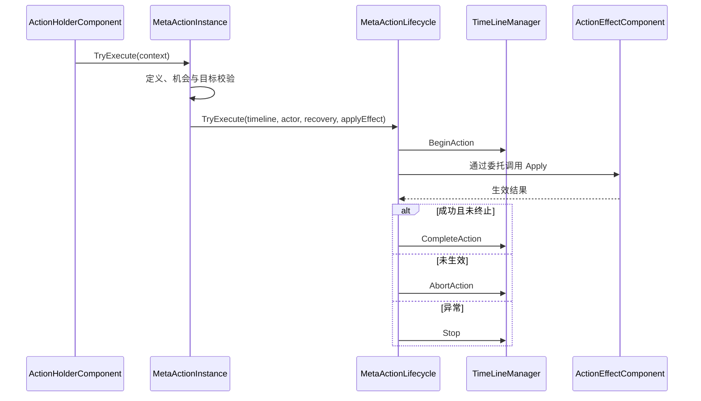

# MetaActionLifecycle 统一执行入口代码设计案

MetaActionLifecycle 是动作内部统一的同步执行与结束交接器。MetaActionInstance 完成请求校验后，必须通过它的 TryExecute 执行生效委托；它把时间轴开始登记、效果生效、成功完成、拒绝、异常和终止收束在同一条执行路径中，使效果组件不各自决定何时回排。

| 项目 | 内容 |
| --- | --- |
| 解释范围 | Assembly-CSharp，全局命名空间；MetaActionLifecycle、MetaActionPhase，及其持有/调用边界 |
| 源码依据 | MetaActionLifecycle.TryExecute/Reject/Terminate；MetaActionInstance 的 lifecycle 字段与 TryExecute/Dispose |
| 核对基线 | 工程 7362b95addd908be4f96110c2c51ad0300af8e58；2026-10-27；相关源码无未提交差异 |
| 关联设计 | [元动作 §4.3 角色行为生命周期](../系统设计文档/01-通用系统/70-元动作/70_元动作设计补充说明.md) |
| 状态 | 已核对：结构、统一入口与源码行为 |
| 更新日期 | 2026-10-27 |

## 结构地位、所有者与作用域

MetaActionLifecycle 是 sealed 普通 C# 类，直接隐式继承 System.Object，不继承 MonoBehaviour、MetaObjectComponent 或 TimeLineManager。MetaActionInstance 的 readonly lifecycle 字段在每次构造动作实例时 new 一个执行器；这是独占组合关系，执行器不是场景组件，也不是全局单例。

MetaActionPhase 是同文件的 enum，表示 Idle、Executing、Completed、Rejected、Failed、Terminated。Phase 与执行阶段的 LastError 实际存储在执行器；动作实例公开 Phase 转读它，但动作实例还保存自己的 LastError，用于包含受理前错误。

TimeLineManager 引用在 TryExecute 进入时暂存为 activeTimeline，finally 清空，仅供执行期间终止时 Stop 使用。执行器不拥有整场战斗的参战表，也不选择下一行动者；这些状态在[TimeLineManager](50_TimeLineManager与战斗装配类型代码设计案.md)。这里的“统一”指当前动作通用的生命周期执行协议，当前实际接入的效果是移动与待机：两者都以生效委托进入同一路径，待机不修改领域状态，只以成功结果结束行动。

## 统一入口和方法声明归属

| 实际声明方法 | 调用方 | 下游与职责 |
| --- | --- | --- |
| MetaActionInstance.TryExecute | ActionHolderComponent.TryExecute | 定义、能力、角色、机会与目标校验后，调用生命周期统一入口 |
| MetaActionLifecycle.TryExecute | 当前动作实例 | BeginAction → applyEffect → CompleteAction 或 AbortAction/Stop；执行阶段的统一次序与结果出口 |
| MetaActionLifecycle.Reject | 动作实例的受理前 Reject | 未执行且未终止时记录拒绝阶段，不进入效果 |
| MetaActionLifecycle.Terminate | MetaActionInstance.Dispose | 执行中停止关联时间轴，清空引用并进入终止阶段 |
| MovementEffectComponent.Apply | 动作实例传入的生效委托 | 调用移动能力；本身没有权力调用 CompleteAction |
| WaitEffectComponent.Apply | 动作实例传入的生效委托 | 不做领域修改，恒返回成功；结束与回排仍由执行器完成 |

上图说明带时间轴路径；方法调用不改变成员归属。生效委托由动作实例创建，内部查找唯一效果组件并调用 Apply；生命周期执行器只接收 Func&lt;bool&gt;，不直接认识地图、鼠标或具体移动组件。

## 一次执行的阶段与结束

Executing 或 Terminated 阶段拒绝再次进入；空角色或空委托被拒绝。带时间轴时先 BeginAction，确认机会与后摇可受理才进入 Executing，保证非法后摇不会在效果生效后才发现。没有时间轴时可以独立执行效果，没有回排交接。

委托同步返回后，如果执行期间已终止或时间轴已停止，阶段为 Terminated，返回 false；不能据此保证效果尚未发生。委托返回未生效时 AbortAction，阶段 Rejected，时间轴保留当前机会。成功则 CompleteAction 回排后标 Completed。

委托或后续交接抛异常时，执行器停止时间轴，标 Failed，记录消息并重新抛出。可能已经发生部分业务变化，没有统一回滚或自动重试。finally 清除 activeTimeline，因此执行器不会在正常结束后继续持有本次活跃时间轴引用。

Completed、Rejected 甚至非终止失败阶段在本类中没有一次性销毁限制；正常动作实例继续存在。终止通过 MetaActionInstance.Dispose 先调用生命周期 Terminate，再调用 base.Dispose 清理动作组件。执行中的 Terminate 会 Stop，已结束的 Terminate 仅收束自身阶段。

## 结果和边界

生命周期 TryExecute 返回 true 表示效果成功并完成正常结束交接。动作实例还将内部 ActionResult 与生命周期完成结果合并：效果成功但结束未成功时不会对外返回 Succeeded。受理前的定义/目标失败由动作实例负责，生命周期执行器不重新执行这些业务校验。

这是同步执行，没有跨帧等待、取消令牌、超时、重试或动画完成回调。对象内消息处理器的异常可能被底座单独记录而不传播，所以成功执行也不证明所有表现订阅者都成功。动作执行与画面播放的运行结果仍需工程验证。

## 实现定位

- [MetaActionLifecycle.cs](D:/myspace/Git/mygame/Assets/Script/Battle/MetaActionLifecycle.cs)：阶段状态、TryExecute、Reject、Terminate。
- [MetaActionInstance.cs](D:/myspace/Git/mygame/Assets/Script/Battle/MetaActionInstance.cs)：独占持有、受理入口、生效委托与释放调用。
- [TimeLineManager.cs](D:/myspace/Git/mygame/Assets/Script/Battle/TimeLineManager.cs)：被交接的 BeginAction、CompleteAction、AbortAction、Stop。
- [MetaActionComponents.cs](D:/myspace/Git/mygame/Assets/Script/Battle/MetaActionComponents.cs)：具体效果抽象层与移动效果。
