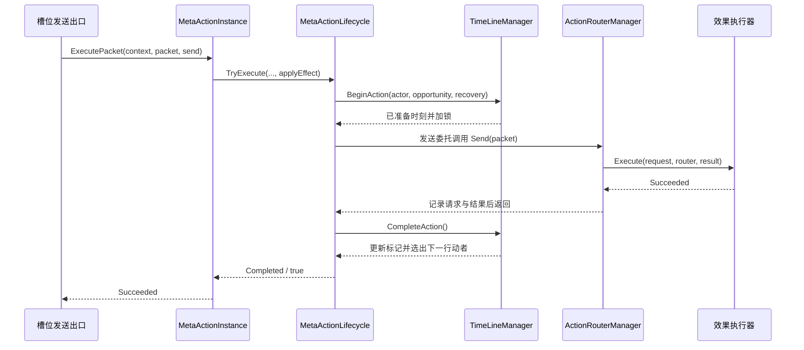

# MetaActionLifecycle 统一执行入口代码设计案

MetaActionLifecycle 把一次同步动作的开始、效果返回、成功回排、拒绝和异常收束到同一入口。每个 MetaActionInstance 独占一个生命周期，时间轴在效果执行前准备回排时刻并加锁，只有效果成功且执行过程保持有效时才完成回排。

| 项目 | 内容 |
| --- | --- |
| 解释范围 | Assembly-CSharp，全局命名空间；MetaActionLifecycle、MetaActionPhase 与 MetaActionInstance.ExecutePacket 对时间轴和 Router 的编排 |
| 源码依据 | MetaActionLifecycle.TryExecute/Terminate；MetaActionInstance.ExecutePacket；TimeLineManager.BeginAction/CompleteAction/AbortAction/Stop；文件入口见文末实现定位 |
| 核对基线 | 工程提交 `bf1b4d8caf90a8d6e10de503f1e682b96bb3b936`；2026-10-30 核对源码与静态资产 |
| 关联设计 | [元动作 §4.3 角色行为生命周期](../系统设计文档/01-通用系统/70-元动作/70_元动作设计补充说明.md) |
| 状态 | 已核对：源码声明、调用链与静态资产绑定 |
| 更新日期 | 2026-10-30 |

## 类与入口的结构地位

MetaActionLifecycle 是 Assembly-CSharp 的普通 C# sealed 类，由 MetaActionInstance 私有持有。TryExecute 是该动作实例的同步生命周期入口；它接受时间轴、角色、机会编号、后摇和返回 bool 的生效委托。场景 Router 的 Send 承担报文分发，生命周期的 TryExecute 承担动作与时间轴之间的开始和完成关系。

| 声明方法 | 调用关系与职责 |
| --- | --- |
| MetaActionInstance.ExecutePacket | 槽位发送出口调用；读取报文后摇，提供将 ActionResult 转成成功判定的委托 |
| MetaActionLifecycle.TryExecute | 调用 BeginAction、发送委托和 CompleteAction/AbortAction；维护本动作 Phase、Result 与 LastError |
| MetaActionLifecycle.Terminate | 生命周期终止；执行中同时停止 activeTimeline |
| TimeLineManager.BeginAction | 检查机会并准备下一时刻，设置执行锁 |
| TimeLineManager.CompleteAction / AbortAction | 分别提交回排并授予机会、释放锁并保留当前机会 |

## 成功链路

动作已经 Executing 或 Terminated 时 TryExecute 返回 false，Result 为 NotReady。绑定时间轴时先调用 BeginAction；当前机会不符时，Phase 转 Rejected，Result 承接 OutOfTurn，生效委托保持未调用状态。时间轴参数可以为空，此时执行使用同一相态规则，效果通过 Router 完成。

BeginAction 成功后保存临时 activeTimeline，Phase 进入 Executing，清空 LastError 并同步调用委托。委托返回 true 后还要确认生命周期及时间轴保持有效，再 CompleteAction 并转 Completed。activeTimeline 在 finally 中清空，本动作保留 Phase、Result 与 LastError 供调用方读取。

## 拒绝、终止与异常

| 情形 | 生命周期结果 | 时间轴与已发生效果 |
| --- | --- | --- |
| BeginAction 失败 | Phase 为 Rejected，Result 承接时间轴结果并记录原因 | 当前标记和机会保留 |
| 发送委托返回 false | Rejected，记录行为未生效 | AbortAction 解锁，当前机会保留 |
| 委托执行期间动作终止或时间轴停止 | Terminated，记录执行期间终止 | 停止授予后续机会，已发生变化保留 |
| 委托、Router 日志写入或完成步骤抛异常 | Failed，记录异常并重新抛出 | Stop 停止调度，已发生变化保留 |
| 空时间轴且委托成功 | Completed | 完成动作自身阶段 |

Terminate 在 Executing 时调用 activeTimeline.Stop，随后转 Terminated。MetaActionInstance.Dispose 同时调用该入口和元对象底座清理。Completed 与 Rejected 动作可以再次进入 TryExecute；已终止动作通过容器 Prepare 建立新的实例。

Router 的请求结果记录在 Send 的 finally 中形成，发生在 CompleteAction 之前。因此路由结果中的 Succeeded 表示执行器成功；动作整体是否 Completed 还取决于后续生命周期。Send 以前的机会拒绝由动作结果与错误信息表达，日志覆盖的精确边界见 [90 Router 专题](90_ActionRouterManager与键值报文执行代码设计案.md)。

## 时间与表现边界

整个入口同步完成，以委托的返回值决定效果是否成功。动画、相机和 UI 读取结果并处理显示。时间轴使用离散游戏秒，后摇由构造器提供的报文字段决定；世界帧时间只参与表现与输入。执行异常可能发生在坐标等状态已经变动之后，调用者应以当前实例状态和日志结果理解此次执行。

## 实现定位

| 源码或资产 | 主要定位 |
| --- | --- |
| [MetaActionLifecycle.cs](D:/myspace/Git/mygame/Assets/Script/Battle/MetaActionLifecycle.cs) | 相态、Result、TryExecute、Terminate |
| [MetaActionInstance.cs](D:/myspace/Git/mygame/Assets/Script/Battle/MetaActionInstance.cs) | ExecutePacket 的参数读取与生命周期结果承接 |
| [TimeLineManager.cs](D:/myspace/Git/mygame/Assets/Script/Battle/TimeLineManager.cs) | 开始、回排、解锁与停止 |
| [ActionPackets.cs](D:/myspace/Git/mygame/Assets/Script/Battle/ActionPackets.cs) | 槽位发送出口 |
| [ActionRouterManager.cs](D:/myspace/Git/mygame/Assets/Script/Battle/ActionRouterManager.cs) | 同步 Send、finally 记录与异常传播 |

核对依据为上述提交的源码、工程配置与静态资产。文档状态表示所述实现已完成对照；编译、播放、画面与交互的运行验证属于独立验证范围。
