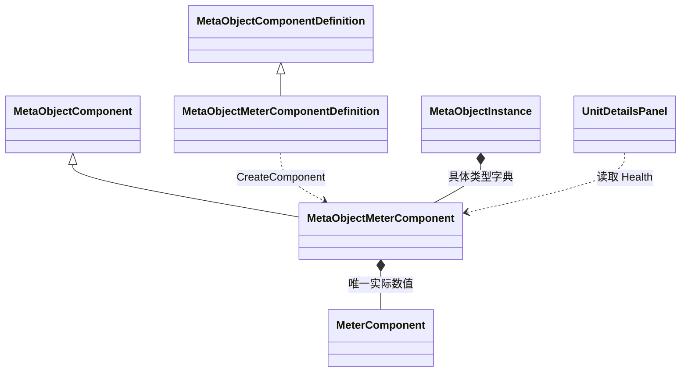

# 量表组件与生命显示代码设计案

MetaObjectMeterComponent 提供通用量表：每个运行实例保存下限、上限和可变实际值，通过 Modify 接收增减并在实际变化时通知调用方。角色生命是 MeterId 为 Health 的配置应用，底部面板从各角色量表读取当前值和上限。

| 项目 | 内容 |
| --- | --- |
| 解释范围 | Assembly-CSharp，全局命名空间；MetaObjectMeterComponentDefinition、MetaObjectMeterComponent、MeterComponent 及 UnitDetailsPanel 生命摘要 |
| 源码依据 | MetaObjectMeterComponent.Modify/OnDetached；MeterComponent.Modify；UnitDetailsPanel.RefreshHealth；文件入口见文末实现定位 |
| 核对基线 | 工程提交 `bf1b4d8caf90a8d6e10de503f1e682b96bb3b936`；2026-10-30 核对源码与静态资产 |
| 关联设计 | [元对象与组件](../系统设计文档/01-通用系统/30_元对象与组件设计补充说明.md)、[战斗总览](../系统设计文档/06-战斗/10-战斗总览/10_战斗总览设计.md) 的单位状态（术语表 T-113）与固定属性 |
| 状态 | 已核对：源码声明、调用链与静态资产绑定 |
| 更新日期 | 2026-10-30 |

## 类型归属与数值所有权

MetaObjectMeterComponentDefinition 继承 MetaObjectComponentDefinition，以用途标识、下限、上限和初值创建 MetaObjectMeterComponent。运行组件继承 MetaObjectComponent，私有持有一个实现 ItemComponent 标记接口的 MeterComponent。UnitDetailsPanel 是读取量表的 MonoBehaviour。相关类型由 Assembly-CSharp.csproj 列为 Compile 项。

MeterComponent 持有实际数值，外层通过只读 Minimum、Maximum、Value、MeterId 暴露结果。共享角色定义提供创建输入，每个角色运行实例建立自己的内层量表。组件字典按具体类型保存，因此每个角色容纳一个 MetaObjectMeterComponent；用途由该组件的 MeterId 与调用者解释。

## 配置与创建

minimum、maximum 和 initialValue 由配置直接传入运行量表。内层构造器使用 Mathf.Clamp 将初值限制在区间内，支持负数区间、上下限相等及范围外初值。

MetaObjectDefinition.CreateInstance 逐项调用配置的 CreateComponent，并通过统一底座挂载。运行组件创建独立的 MeterComponent 保存数值。MetaObjectPreset 负责场景绑定，数值归属独立于场景显示。

## 增减、通知与生命周期

Modify 接受数值增量，正数增加、负数减少；先保存修改前值，再调用内层 MeterComponent.Modify，读取修改后值并返回“修改后减修改前”。内层使用 Mathf.Clamp 限定结果；近似 0 的增量提前返回。外层仅在 after 与 before 不等时同步触发 ValueChanged，参数为修改前后值。

| 情形 | 数值与外层通知 |
| --- | --- |
| 增加越过上限 | 停在上限，返回实际增量，发出变化事件 |
| 减少越过下限 | 停在下限，返回实际减少量，发出变化事件 |
| 边界处继续向外修改 | 保持边界值，返回 0，事件保持静默 |
| 增量近似 0 | 内层提前结束，实际值保持 |

ValueChanged 在数值提交后调用，处理器抛出的异常沿调用栈传播，数值保留提交结果。解绑场景保留数值；OnDetached 清空外层监听；重建角色按定义初值创建新量表。当前值属于运行数据，保存和恢复需以具体持久化入口为依据。

内层 MeterComponent 还提供检查点集合和 OnCheckpointReached。角色量表创建路径直接调用 MeterComponent 构造器，检查点保持空集合；物品侧 MeterComponentData.CreateComponent 则设置检查点，并使用 minValue 作为构造初值。两条工厂路径各有自己的输入。

## Health 配置与底部摘要

| 角色定义 | MeterId | 下限 | 上限 | 初值 |
| --- | --- | --- | --- | --- |
| Player | Health | 0 | 100 | 100 |
| Unit_02_Timeline | Health | 0 | 150 | 120 |
| Unit_03_Timeline | Health | 0 | 80 | 60 |

UnitDetailsPanel.RefreshHealth 按 0.5 秒间隔缓存场景角色清单，按 MetaObjectId 排序；每帧从启用且已绑定角色的当前实例读取 MeterId 精确为 Health 的量表，将名称、Value 与 Maximum 拼成摘要。无符合条件角色时显示 HP -。清单范围是场景角色，参战身份与当前行动者另由时间轴管理。

HealthSummary 是 UnitDetails 面板顶部的 TMP 文本，面板高 236 参考像素，使用 UnitDetails SDF。调用者通过 Modify 修改实际值后，摘要下一次 Refresh 即可读取该值。面板自身只负责查询与显示，主要结构见 [70 面板专题](70_UnitDetailsPanel与移动选择界面代码设计案.md)。

## 功能范围

量表负责区间钳位、运行值与变化通知；Health 应用负责配置和生命摘要。当前 Router 操作集合为 Movement、Wait 与 FixedDamage。固定伤害通过量表 Modify 扣减 Health，执行器与对象选取见 [95 对象指向与固定伤害](95_对象指向与固定伤害代码设计案.md)。治疗、反伤、伤势、击倒、死亡及生命驱动的行动资格仍未实现。DebugPanel.HealPlayer 是空方法，编辑期量表验证工具属于独立验证入口。

## 实现定位

| 源码或资产 | 主要定位 |
| --- | --- |
| [MetaObjectMeterComponent.cs](D:/myspace/Git/mygame/Assets/Script/MetaObjects/MetaObjectMeterComponent.cs) | 配置输入、独占量表、Modify 与事件清理 |
| [MeterComponentData_SO.cs](D:/myspace/Git/mygame/Assets/Script/Components/MeterComponentData_SO.cs) | MeterComponent 钳位、检查点与物品侧工厂 |
| [ItemComponent.cs](D:/myspace/Git/mygame/Assets/Script/Components/ItemComponent.cs) | 标记接口及配置基类 |
| [UnitDetailsPanel.cs](D:/myspace/Git/mygame/Assets/Script/UI/UnitDetailsPanel.cs) | RefreshHealth |
| [UI.unity](D:/myspace/Git/mygame/Assets/Scenes/UI.unity) | HealthSummary 和字体绑定 |
| [Player.asset](D:/myspace/Git/mygame/Assets/GameData/MetaObjects/Player.asset) | 100 / 100 Health |
| [Unit_02_Timeline.asset](D:/myspace/Git/mygame/Assets/GameData/Battle/Unit_02_Timeline.asset) | 120 / 150 Health |
| [Unit_03_Timeline.asset](D:/myspace/Git/mygame/Assets/GameData/Battle/Unit_03_Timeline.asset) | 60 / 80 Health |
| [DebugPanel.cs](D:/myspace/Git/mygame/Assets/Script/Debug/DebugPanel.cs) | HealPlayer 的实现范围 |

核对依据为上述提交的源码、工程配置与静态资产。文档状态表示所述实现已完成对照；编译、播放、画面与交互的运行验证属于独立验证范围。
