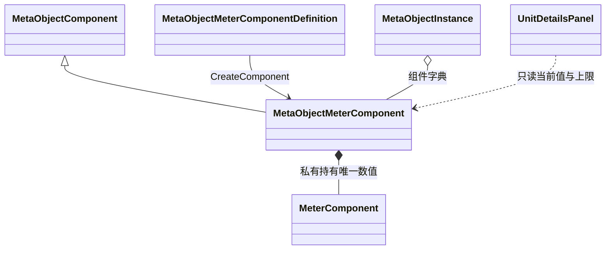

# 量表组件与生命显示代码设计案

战斗需要一种与固定属性分开、可以被增减的动态数值。当前实现把它做在 MetaObjectMeterComponent 上：每个角色实例独占一个量表，保存下限、上限与当前值，并以 `Modify` 接收增减；底部详情面板再读取场上角色的生命应用，汇总成一行实时数值。量表只负责数值与变化通知，不包含伤害、治疗、死亡或行动资格规则。

| 项目 | 内容 |
| --- | --- |
| 解释范围 | Assembly-CSharp，全局命名空间；MetaObjectMeterComponentDefinition、MetaObjectMeterComponent，被复用的 MeterComponent，以及 UnitDetailsPanel 的生命摘要读取与 UI 场景绑定 |
| 源码依据 | `MetaObjectMeterComponent` 的构造、ValidateConfiguration、Modify、OnDetached；`MeterComponent` 的 Value/Modify；`UnitDetailsPanel.RefreshHealth/Refresh`；三份角色定义的量表配置 |
| 核对基线 | 工程 8468fb91c225447ff0a329a020d7fcd7fe5e7857，并入核对日期时的工作区改动：MetaObjectMeterComponent.cs 与 MeterVerification.cs 为新增未跟踪文件，Player.asset、Unit_02_Timeline.asset、Unit_03_Timeline.asset、UI.unity、UnitDetailsPanel.cs 与两份 csproj 有未提交修改；2026-10-26 |
| 关联设计 | [元对象与组件](../系统设计文档/01-通用系统/30_元对象与组件设计补充说明.md)、[战斗总览](../系统设计文档/06-战斗/10-战斗总览/10_战斗总览设计.md) 的单位状态（术语表 T-113）与固定属性 |
| 状态 | 已核对：结构、源码与静态绑定；未执行编译、播放或编辑器验证 |
| 更新日期 | 2026-10-26 |

## 功能目的与当前结果

角色已有由配置提供的行动力、力量与行动速度，但它们是只读的固定属性，不能承载会变化的生命。量表组件补上这一点：它让每个运行角色拥有自己的当前值与上下限，并允许调用方增加或减少；界面侧不再另存一份血量，而是每帧读取量表的当前值与上限，把全场角色的生命排成一行显示。结果是“数值可以被改、显示会跟着变”，但当前没有战斗行为真的去改它。

## 类型归属与数值所有权

三个类型分属两套组件模型。MetaObjectMeterComponent 系列属于元对象组件体系，随角色实例创建；MeterComponent 属于工程原有的物品组件模型，只作为被复用的数值容器。

| 声明类型 | 直接基类或形态 | 归属与职责 |
| --- | --- | --- |
| MetaObjectMeterComponentDefinition | MetaObjectComponentDefinition | 角色定义中的量表配置，保存用途标识、下限、上限与初值，创建运行组件 |
| MetaObjectMeterComponent | MetaObjectComponent | 由角色元对象实例持有，私有持有一个 MeterComponent；对外只读上下限、当前值与用途标识，并提供 Modify 与 ValueChanged |
| MeterComponent | 实现 ItemComponent 标记接口的普通类 | 原有量表容器，持有唯一的当前值并在赋值时钳位，另带检查点与自身事件；不是元对象组件 |
| MeterComponentData / MeterComponentData_SO | ItemComponentData&lt;MeterComponent&gt; 与 ScriptableObject | 原有物品侧的配置与资产，本轮不经过该工厂创建角色量表 |
| UnitDetailsPanel | MonoBehaviour | 只读汇总并显示场上角色的生命；不持有量表或角色状态 |

这里没有第二个当前值：MetaObjectMeterComponent 不复制数值到 AttributeComponent，也不让面板保存副本。定义与运行组件是两个对象，定义被角色共享，运行组件随实例创建。类型上用 `MovedFrom` 记录了由 HealthMeterComponent/HealthMeterComponentDefinition 更名的来源，使三份角色资产改为新类型后仍保留序列化引用；这属于迁移信息，不代表源码还保留旧类。

## 配置、创建与数值规则

角色定义清单中的一项 `MetaObjectMeterComponentDefinition` 提供用途标识（当前为 `Health`）、下限、上限与初值。创建时要求三个数值都有限、且上限不小于下限；允许负数区间，也允许上下限相等。初值超出范围不报错，而是沿用 MeterComponent 构造时的钳位规则。

创建沿对象定义的统一入口：MetaObjectDefinition.CreateInstance 逐项调用配置的 CreateComponent，再把组件挂到实例；场景承载绑定后组件才可用。每个实例各自创建组件与内层量表，因此给一个角色扣血不会改动定义或其他角色。配置非法时异常发生在创建阶段，实例创建失败并按底座规则清理已建部分，不会留下半个角色。

## 增减、通知与保留

`Modify(amount)` 是唯一的数值入口：正数增加、负数减少，返回本次实际变化量。它先检查入参有限，再交给 MeterComponent 修改；后者用属性赋值钳位到上下限，并在自身触发旧值/新值事件与检查点判定。外层仅在数值真的变化时发出自己的 `ValueChanged(旧值, 新值)`，并把实际增减量算成修改后的值减修改前的值。

| 输入情形 | 结果 |
| --- | --- |
| 增加但被上限截断 | 当前值停在上限，返回被截断后的实际增量，发出一次变化通知 |
| 减少但被下限截断 | 当前值停在下限，返回实际减少量，发出一次变化通知 |
| 已在上限继续增加或已在下限继续减少 | 数值不变、返回 0、不通知 |
| 增量为 0 或近似 0 | 内层提前返回，数值与通知都不变 |
| NaN、无穷或非法范围 | 抛异常或拒绝创建，不改变已有数值 |

解绑场景不会重置数值，卸载组件才清理外部监听（`OnDetached` 把 ValueChanged 置空）。新建元对象会按定义重新初始化，所以当前值属于运行状态，不是存档数据；工程没有把量表写入存档的流程。内层 MeterComponent 自带的检查点与事件在本路径中没有被配置或订阅，不能被当成已经生效的生命分档逻辑。

## 底部生命摘要的读取与显示

UnitDetailsPanel 的 `RefreshHealth` 负责显示。它先取场景中所有 MetaObjectPreset，每 0.5 秒（不受缩放时间影响）重扫一次清单并重扫时按定义的 MetaObjectId 排序；随后逐项跳过未激活、未绑定或没有量表的承载，只接受用途标识严格等于 `Health` 的量表，把“显示名 当前值 / 上限”以固定分隔拼成一行，写入 `HealthSummary` 文本；没有任何可显示角色时写 `HP -`。

这段显示与当前行动者无关，也不依赖时间轴是否启动：战斗开始前、等待机会时都会列出所有符合条件的已绑定角色。数值本身每帧从当前实例读取，所以只要有人调用 Modify，下一帧文本就会反映新值；显示不通过 ValueChanged 订阅，也没有变化检测，字符串每帧重建。`DisplayedHealth` 暴露最终文本，供外部只读检查。场景中 `HealthSummary` 是 UnitDetails 面板顶部的一条 TMP 文本，使用与面板其他文字相同的 `UnitDetails SDF` 字体资产；面板高度当前为 236 参考像素。

三份常驻角色定义的量表配置为：Player 上限 100、初值 100；Unit_02 上限 150、初值 120；Unit_03 上限 80、初值 60。三者当前值互不相同，便于分辨显示。

## 结果、边界与当前限制

- **只有数值与显示，没有伤害/恢复来源。** 运行代码中除 `UnitDetailsPanel` 的读取外，没有战斗效果、技能或调试按钮调用 `Modify`；DebugPanel 的“恢复满状态”仍是空实现。因此“伤害或恢复后界面显示变化”目前只能证明显示会跟随当前值，不能证明工程内已有造成伤害或治疗的行为。编辑器验证脚本可以驱动数值，但它是编辑期工具，不是运行入口，本轮也未执行。
- **量表数值不等于设计中的单位状态。** 现有实现只有上下限与当前值，没有术语表 T-113/T-114 的三档生命状态、T-115 伤势或 T-116 击倒，也没有零血后的行动资格或死亡处理。
- **没有多量表容器。** 组件字典按具体类型保存，一个角色只能挂一个 MetaObjectMeterComponent；当前没有同时保存生命、体力等多个量表的容器。底部摘要也只显示 `Health`，其他用途标识会被跳过。
- **摘要是全场扫描，不是参战名单。** 它遍历场景中的全部 MetaObjectPreset，凡已绑定且带 Health 量表都会列出，不区分是否已登记参战、敌我或是否在当前战斗中。
- **不是存档结构。** 当前值仅存在于运行组件；重开场景或重建实例会回到定义初值。
- **复用类型的既有差异。** 物品侧 `MeterComponentData.CreateComponent` 把下限当作初始值传给构造器，而没有使用 `initvalue` 字段；这一既有行为不在角色量表的创建路径上，但复用该工厂的调用方会受影响。

## 实现定位

- [MetaObjectMeterComponent.cs](D:/myspace/Git/mygame/Assets/Script/MetaObjects/MetaObjectMeterComponent.cs)：量表配置、运行组件、数值入口与通知。
- [MeterComponentData_SO.cs](D:/myspace/Git/mygame/Assets/Script/Components/MeterComponentData_SO.cs)：被复用的 MeterComponent 及其物品侧配置。
- [UnitDetailsPanel.cs](D:/myspace/Git/mygame/Assets/Script/UI/UnitDetailsPanel.cs)：生命摘要的扫描、过滤、格式化与刷新调用。
- [UI.unity](D:/myspace/Git/mygame/Assets/Scenes/UI.unity)：UnitDetails 面板、HealthSummary 文本与字体引用。
- [Player.asset](D:/myspace/Git/mygame/Assets/GameData/MetaObjects/Player.asset)、[Unit_02_Timeline.asset](D:/myspace/Git/mygame/Assets/GameData/Battle/Unit_02_Timeline.asset)、[Unit_03_Timeline.asset](D:/myspace/Git/mygame/Assets/GameData/Battle/Unit_03_Timeline.asset)：三份角色量表配置。
- [MeterVerification.cs](D:/myspace/Git/mygame/Assets/Editor/MeterVerification.cs)：编辑期配置/逻辑验证入口，只作定位，不视为运行验证。

## 待核实项

量表的预期变化来源（技能效果、状态或调试入口）尚未实现，无法据代码确认伤害数值与生命状态的换算规则；面板摘要是否应只列参战角色、是否应由变化通知驱动而非逐帧轮询，也缺少设计依据。这些不影响当前“可读写数值并显示”的结构结论，但影响生命系统的完整行为判断。
