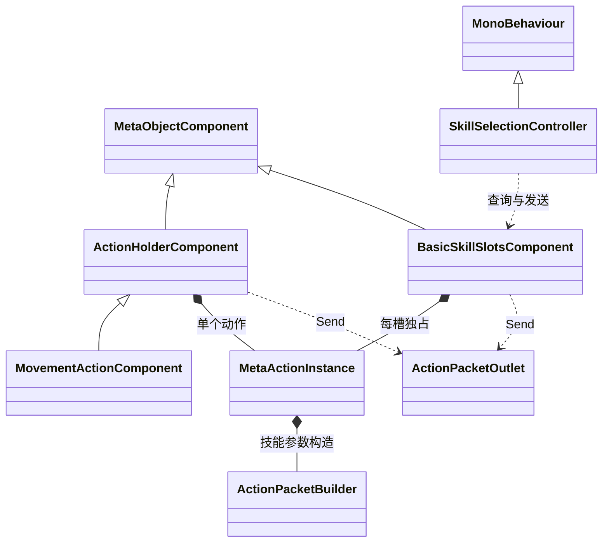

# 基础技能槽与待机动作代码设计案

BasicSkillSlotsComponent 为角色提供固定四槽，每个槽持有自己的动作实例；MovementActionComponent 与其并列，持有一个移动动作。玩家选中槽位后按指向性确认，槽位调用统一发送出口构造并补齐报文，通过动作生命周期和 Router 执行；待机成功后按配置后摇回排。

| 项目 | 内容 |
| --- | --- |
| 解释范围 | Assembly-CSharp，全局命名空间；BasicSkillSlotsComponentDefinition/Component、ActionHolderComponent/MovementActionComponent、SkillSelectionController 与待机配置 |
| 源码依据 | BasicSkillSlotsComponent.Prepare/TryExecute/Terminate；ActionHolderComponent.TryExecute；SkillSelectionController.SelectSlot/Confirm/ExecuteCell/ProcessPointer；文件入口见文末实现定位 |
| 核对基线 | 工程提交 `65c2ff5e40cec060988b74091e189e09fdaa9e13`；2026-10-29 核对时工程工作区干净 |
| 关联设计 | [元动作设计补充说明 §4.3、§4.4](../系统设计文档/01-通用系统/70-元动作/70_元动作设计补充说明.md)、[时间轴与行动顺序](../系统设计文档/06-战斗/20-时间轴与行动顺序/20_时间轴与行动顺序设计.md) |
| 状态 | 已核对：源码声明、调用链与静态资产绑定 |
| 更新日期 | 2026-10-29 |

## 容器、动作与场景适配

这些类型属于 Assembly-CSharp 的全局命名空间。BasicSkillSlotsComponentDefinition、MovementActionComponentDefinition 继承 MetaObjectComponentDefinition，通过 CreateComponent 建立对象侧组件。BasicSkillSlotsComponent 直接继承 MetaObjectComponent；MovementActionComponent 通过 ActionHolderComponent 继承该基类。

槽组件保存定义引用和独立动作实例，角色运行对象负责挂载与释放槽组件。SkillSelectionController 是角色 GameObject 上的场景组件，保存选择槽号、机会和实例引用；BattleTimelineController 在启动时为带槽角色按需添加它，再绑定时间轴。UnitDetailsPanel 将按钮选择转发给该控制器。

## 配置、准备与释放

基础技能定义数组必须正好四项，单项可以为空；构造时复制四个定义引用。Prepare 要求组件已有 Owner，为空实例或 Terminated 动作按各自定义建立新实例。OnAttached、OnBind 及战斗启动调用 Prepare。OnUnbind 终止动作；OnDetached 终止并清空实例数组。

移动容器 OnAttached 按定义创建单个动作，OnBind 补建空动作；Prepare 对已有 Terminated 动作创建新实例。OnUnbind 与 OnDetached 终止并清空所持动作。两类容器各自持有实例，共享动作定义资产。

三名角色各有一个移动容器和一个四槽容器；十二个基础槽都引用 WaitAction，同一份待机定义对应十二份运行实例和生命周期。移动使用 MovementAction 与独立按钮。

## 槽位发送入口

BasicSkillSlotsComponent.TryExecute 先检查索引 0—3、Owner 与执行上下文，要求 context.Actor 与 Owner 是同一实例，再调用 ActionPacketOutlet.Send，slot 字段使用该槽的零基索引字符串。ActionHolderComponent.TryExecute 核对同样归属并要求 Action 存在，发送时 slot 为 Movement。

共享出口调用动作构造器生成报文，来源和实际目标由出口补齐。动作构造器提供 operation、targetKind、recovery；构造器已填写 source 或 target 时出口拒绝。之后登记来源，调用 MetaActionInstance.ExecutePacket 进入生命周期，再发送至 Router。字段、快照与执行器匹配以 [90 Router 专题](90_ActionRouterManager与键值报文执行代码设计案.md) 为主要说明。

## 选择、确认与结果

1. SelectSlot 由按钮或数字键 1—4 触发，要求角色绑定、适配器启用、时间轴允许控制、索引有效且动作定义有效。它取消移动和前一个槽选择，记录槽号、机会编号与当前角色实例。
2. Cell 指向性由地图高亮和选格流程确认。CharacterMovementController 查询 SelectedCellAction 的目标，构造包含实际目的格及移动能力的上下文，通过 ExecuteCell 交给槽位。
3. None 指向性通过再次选择同一槽调用 Confirm，或由 GridClickInput 将场景左键按松过程交给 ProcessPointer。按下和松开均需满足界面遮挡条件，确认上下文使用当前角色、机会、时间轴与 Router。
4. 生命周期对当前机会加锁，Router 按 operation 调用执行器。成功后时间轴完成回排，控制器清理选择并 NotifyActionFinished；执行器返回拒绝时当前机会保留，选择可以继续等待确认。

SelectedIndex 持续比较当前机会与记录机会、当前角色实例与记录实例。机会切换、实例重建、适配器禁用、应用失焦或暂停会使选择失效或取消；移动选择和右键也清理技能选择。地图输入先处理右键，再尝试无目标确认，之后处理地格选格。完整按压语义见 [60 移动与输入](60_地图与移动适配类型代码设计案.md)。

## 待机报文与界面配置

WaitAction 的定义标识为 ACTION_WAIT，显示名为待机；唯一组件配置为 WaitPacketBuilderDefinition，targetKind 为 None，timing 引用 WaitTiming，后摇 10。WaitPacketBuilder 构造 operation 为 Wait 的参数，槽位添加来源和机会等上下文，省略实际目标。WaitEffectExecutor 要求 targetKind 为 None 且来源可解析，返回 Succeeded。生命周期随后按后摇完成行动。

四个底部技能按钮放在 BaseSkills 容器，显示“序号 · 待机”和“后摇 10”。按钮选中颜色与移动选择一致，交互资格来自当前角色控制权及动作定义校验。按钮数量、标签索引和背景 Image 接线见 [70 面板专题](70_UnitDetailsPanel与移动选择界面代码设计案.md)。

## 实现范围与核验条件

当前资产提供独立移动和四槽待机；代码同时具备地格槽动作的查询与发送路径。地格槽分支的实际交互核验需要将有效 Cell 动作配置到槽位并运行场景。技能成本、冷却、伤害与反应效果属于未实现能力。选择状态、机会记录与各槽动作生命周期属于运行数据，角色重建和战斗重新装配时按对应生命周期初始化。

## 实现定位

| 源码或资产 | 主要定位 |
| --- | --- |
| [BasicSkillSlotsComponent.cs](D:/myspace/Git/mygame/Assets/Script/MetaObjects/BasicSkillSlotsComponent.cs) | 固定四槽、Prepare、TryExecute、Terminate |
| [MovementActionComponent.cs](D:/myspace/Git/mygame/Assets/Script/MetaObjects/MovementActionComponent.cs) | ActionHolderComponent 与移动容器 |
| [SkillSelectionController.cs](D:/myspace/Git/mygame/Assets/Script/Player/SkillSelectionController.cs) | 选择、确认、ExecuteCell 与输入 |
| [ActionPackets.cs](D:/myspace/Git/mygame/Assets/Script/Battle/ActionPackets.cs) | 两类容器共用的 ActionPacketOutlet.Send |
| [ActionPacketBuilders.cs](D:/myspace/Git/mygame/Assets/Script/Battle/ActionPacketBuilders.cs) | WaitPacketBuilder 与指向性/后摇 |
| [WaitEffectExecutor.cs](D:/myspace/Git/mygame/Assets/Script/Battle/WaitEffectExecutor.cs) | 待机执行器 |
| [BattleTimelineController.cs](D:/myspace/Git/mygame/Assets/Script/Battle/BattleTimelineController.cs) | 槽准备与场景适配器装配 |
| [WaitAction.asset](D:/myspace/Git/mygame/Assets/GameData/Battle/WaitAction.asset) | 单项构造器配置 |
| [WaitTiming.asset](D:/myspace/Git/mygame/Assets/GameData/Battle/WaitTiming.asset) | 待机后摇 |
| [Player.asset](D:/myspace/Git/mygame/Assets/GameData/MetaObjects/Player.asset) | 移动与四槽引用 |
| [Unit_02_Timeline.asset](D:/myspace/Git/mygame/Assets/GameData/Battle/Unit_02_Timeline.asset) | 第二角色四槽 |
| [Unit_03_Timeline.asset](D:/myspace/Git/mygame/Assets/GameData/Battle/Unit_03_Timeline.asset) | 第三角色四槽 |

核对依据为上述提交的源码、工程配置与静态资产。文档状态表示所述实现已完成对照；编译、播放、画面与交互的运行验证属于独立验证范围。
