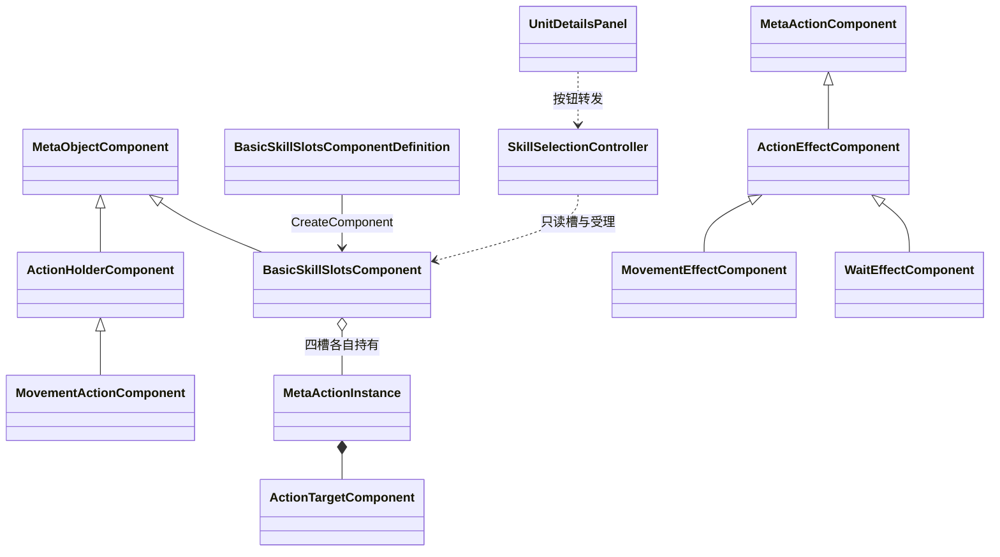

# 基础技能槽与待机动作代码设计案

角色的行为原先只有移动一条路径。本轮实现给角色对象加了固定四槽的技能容器，用待机动作填满并验证选择与确认；同时给动作增加“指向性”维度，把需要选地格的动作与不需要目标、再次确认即释放的动作分开。选择本身只是一份界面意图，确认后才进入元动作的受理与生命周期，成功时结束本次行动并按其配置后摇回排时间轴。

| 项目 | 内容 |
| --- | --- |
| 解释范围 | Assembly-CSharp，全局命名空间；BasicSkillSlotsComponentDefinition/Component、SkillSelectionController、ActionTargetKind 与 ActionTargetComponent、WaitEffectComponent 系列，以及它们与时间轴控制器、移动控制器、输入和详情面板的协作 |
| 源码依据 | BasicSkillSlotsComponent.Prepare/TryExecute/Terminate；SkillSelectionController.SelectSlot/Confirm/CancelSelection/ProcessPointer；MetaActionInstance.ValidateDefinition/TryExecute；UnitDetailsPanel 技能按钮与 Refresh；BattleTimelineController.TryStartBattle/StopBattle/CancelPointers |
| 核对基线 | 工程 7362b95addd908be4f96110c2c51ad0300af8e58；2026-10-27；技能槽组件、待机资产与动作侧脚本在 8468fb9 已提交，7362b95 随后收录生命摘要与布局改动；四个技能按钮、标签及其引用未变 |
| 关联设计 | [元动作设计补充说明 §4.3、§4.4](../系统设计文档/01-通用系统/70-元动作/70_元动作设计补充说明.md)、[时间轴与行动顺序](../系统设计文档/06-战斗/20-时间轴与行动顺序/20_时间轴与行动顺序设计.md) |
| 状态 | 已核对：结构、源码与静态配置；未执行编译、播放或界面验证 |
| 更新日期 | 2026-10-27 |

## 功能目的与当前结果

玩家在轮到己方角色时，应当从若干可选行为中挑一个，而不是一到回合就自动进入移动。当前实现为此提供四个技能槽：界面下方有四个按钮和一个独立的移动按钮，点击或按数字键选择槽位；地格指向的动作选择后还要点高亮地格确认，无指向的动作再按一次同一槽位（或左键点场景空白处）即释放。待机是当前唯一填充的技能，确认后角色不改坐标、不改属性，只按配置的后摇结束本次行动并让时间轴回排。

## 类型归属与两层结构

技能槽不是动作内部的组件，而是角色对象侧的组件，与移动动作的持有组件并列；动作本身仍由 MetaAction 派生类型承担。

| 声明类型 | 直接基类或形态 | 归属与职责 |
| --- | --- | --- |
| BasicSkillSlotsComponentDefinition | MetaObjectComponentDefinition | 角色定义中的四槽配置，保存四个 MetaActionDefinition 引用，创建槽组件 |
| BasicSkillSlotsComponent | MetaObjectComponent | 由角色元对象实例持有；固定四槽，保存共享定义与各槽独占的动作实例，提供读取、准备、受理和终止 |
| ActionHolderComponent / MovementActionComponent | MetaObjectComponent | 原有的对象侧动作持有组件，只持有一个移动动作；与技能槽并列，不在槽内 |
| SkillSelectionController | MonoBehaviour | 场景侧选择适配器，记录当前选中槽号、机会编号与角色实例；不持有技能数据或调度状态 |
| MetaActionInstance | MetaObjectInstance | 全部动作共用的运行实例，读取目标指向性与后摇，承担定义校验和受理 |
| ActionTargetKind / ActionTargetComponent | enum / MetaActionComponent | 动作的指向性分类及其运行组件，决定是否需要地格目标 |
| WaitEffectComponent | ActionEffectComponent | 待机效果，恒为成功，不改变坐标或属性 |
| UnitDetailsPanel | MonoBehaviour | 显示并转发按钮选择，不保存选择有效性 |

同一角色的运行实例同时持有一个 MovementActionComponent 和一个 BasicSkillSlotsComponent；前者仍承载移动，后者承载四个槽位。两者共享同一套动作协议与执行上下文，但槽容器没有把移动纳入其中一个槽。场景侧另有一个 SkillSelectionController，由战斗装配在角色带槽组件时动态添加，不作为序列化组件存在。

## 槽位配置、创建与释放

四个槽由定义中的数组提供。创建时要求数组长度正好为 4：不足、超出或为空都会在创建组件时抛异常，角色实例创建失败并按底座规则清理；槽位本身允许为空引用，空槽显示为“空槽”且按钮不可用。运行组件构造时把定义数组复制到自己的定义槽，因此定义资产共享，运行期不修改共享配置。

每个槽的动作实例按需建立：组件挂载或绑定场景时调用 `Prepare`，对空槽或阶段已终止的槽重新用定义创建实例；战斗启动时装配方也会再准备一次。解绑与卸载都会终止各槽动作，卸载还会清空实例数组。这样同一份待机定义被三个角色、共十二个槽引用，但每个角色每个槽都有独立的动作实例与生命周期，一个槽执行不会推进别的角色或别的槽。

## 指向性、待机效果与受理校验

动作的指向性由目标组件上的 `ActionTargetKind` 表达：`Cell` 需要目的格并交给移动能力校验，`None` 不读目的格而直接视为通过。移动动作资产没有写该字段，取枚举默认值 `Cell`；待机资产显式写为 `None`。效果与指向性必须成对：移动效果要求 `Cell`，待机效果要求 `None`，不匹配时动作在受理前即被拒绝，不会执行到一半才发现配置错误。

待机效果组件的 `Apply` 直接返回成功，含义是“本次行动到此结束”。它不查询地格、不移动坐标、不改属性，也不触发其他效果。动作的定义校验还要求恰好一个目标组件、一个后摇组件和一个效果组件；后摇取不到或非法时同样在受理前拒绝。

## 一次选择、确认与结束

槽位选择与移动选择互斥，二者都由场景适配器保存“意图”，真正的受理统一进入动作实例。

1. **选择槽位。** 面板按钮或数字键 1—4 调用 `SelectSlot`。适配器先要求自身启用、角色已绑定、时间轴允许控制该角色，槽号合法且该槽动作通过定义校验；随后取消移动选择与旧槽选择，记录槽号、当前机会编号和角色实例。地格指向的槽到此只完成选择，不执行。
2. **无指向动作的确认。** 再次选择同一槽位会直接进入 `Confirm`；也可以在地图上左键点一个没有界面遮挡的位置，由输入层转给适配器确认。确认要求该槽指向性为 `None`，用空目的格、空移动能力和当前时间轴构造执行上下文，交给槽组件受理。
3. **地格指向动作的确认。** 选中后，移动控制器把选格查询与高亮切换到该槽动作；玩家点高亮地格时，控制器用目的格和移动能力调用槽组件的 `ExecuteCell`。这条路径与原有移动共用范围查询、投影和确认流程。
4. **受理与执行。** 槽组件核对执行上下文中的角色确为自身 Owner，再交给动作实例；动作实例复核定义、能力、当前行动者、执行锁与机会编号，通过目标校验后进入统一生命周期。
5. **结束。** 待机效果成功即完成本次行动：时间轴把当前行动者的标记推到“当前时刻 + 后摇”并选出下一行动者；成功后适配器清除选择并向时间轴控制器登记最近动作，控制器在完成阶段清理各角色的指针与选择。失败或未生效则保留当前机会，适配器不主动清除选择，选择仍会在机会或实例变化时失效；两种情况都不会被当作已完成。
6. **失效清理。** 机会编号变化、角色实例重建、适配器禁用、应用失焦或暂停、右键取消、切换到移动选择、战斗停止，都会让旧选择失效并清理。选择有效期的判断同时比较机会与实例，避免用旧机会的意图执行新回合。

输入层的顺序是先问技能适配器、再处理地图选格：一次被无指向技能消费的点击不会再派发选格意图；被界面或调试面板遮挡的按下与松开不会确认。右键取消优先于同帧左键。

## 界面与静态配置

界面沿用底部详情面板，新增四个技能按钮与四个标签，原移动按钮保留。四个按钮放在面板内的 `BaseSkills` 容器下，标签是各按钮的子文本；按钮的持久化点击列表为空，业务监听在面板启用时成对添加、禁用时移除，因此切换行动者不会留下重复回调。

面板每次刷新时按槽读取动作与定义：无动作显示“空槽”，有动作显示“序号 · 显示名”和“后摇 数值”；可交互要求适配器可控制且动作定义有效；当前选中的槽用青绿色底，其余用深色。提示文字随状态变为“选择一个动作开始本次行动”“点选高亮地格确认移动 · 右键取消”“再次选择该技能或左键空白场景释放 · 右键取消”等。移动按钮仍单独显示“移动”或“移动 · 已选择”。

动作资产方面，待机定义标识为 `ACTION_WAIT`、显示名“待机”、指向性无、后摇引用 `WaitTiming`（行为标识 `BHV-WAIT-001`，当前 10 游戏秒），效果为待机效果。三份常驻角色定义的四个槽都引用同一份待机定义，因此当前界面的四个按钮显示同一技能。移动动作仍由 `MovementAction` 与 `MovementTiming`（10 游戏秒）承担。

## 结果、边界与当前限制

- **待机的结果是“结束行动”，不是新状态。** 它不产生坐标、属性或量表变化，也不检查除机会、角色与定义之外的条件；其唯一可观察结果是行动标记按配置后摇回排。
- **“把移动归入技能范畴”只在协议层成立。** 移动已经是带地格指向性的元动作，复用同一受理、生命周期和后摇回排，并共用选择界面的交互方式；但它仍由独立的 MovementActionComponent 持有、由独立按钮选择，没有占用四个槽之一，也没有作为槽内容被配置。槽容器与移动容器是并列关系。
- **槽内地格技能路径存在但未配置。** 适配器、移动控制器与槽组件都支持“槽内动作是地格指向”时的查询与提交，但当前三份角色只填充待机，没有第二份地格技能资产可供静态核对这条分支的实际表现。
- **技能内容仍是占位。** 除待机外没有成本、冷却、射程、目标预览、技能分类或敌方决策；四个按钮相同也说明当前用于验证槽位与选择，而不是正式构筑。
- **槽数与装配是硬前提。** 定义必须正好四个槽；面板的技能按钮与标签数组长度需一致，代码按按钮数量索引标签，当前场景为四对四。按钮上必须存在可用的 Image 作为背景，否则刷新取色会失败。
- **选择状态不持久化。** 适配器状态只存在于运行期，重建角色或重开战斗后从无选择开始；没有保存“上次选择”或技能使用记录。
- 工程内存在编辑期验证脚本（`BasicSkillVerification` 等），但本轮没有运行编辑器或游戏，不能把脚本存在当作交互已经验证通过。

## 实现定位

- [BasicSkillSlotsComponent.cs](D:/myspace/Git/mygame/Assets/Script/MetaObjects/BasicSkillSlotsComponent.cs)：四槽配置、运行组件、准备、受理与终止。
- [SkillSelectionController.cs](D:/myspace/Git/mygame/Assets/Script/Player/SkillSelectionController.cs)：选择、确认、机会校验、场景点击确认与取消。
- [MetaActionComponents.cs](D:/myspace/Git/mygame/Assets/Script/Battle/MetaActionComponents.cs)：指向性枚举、目标组件、待机效果及动作上下文。
- [MetaActionInstance.cs](D:/myspace/Git/mygame/Assets/Script/Battle/MetaActionInstance.cs)：指向性读取、定义校验与受理。
- [BattleTimelineController.cs](D:/myspace/Git/mygame/Assets/Script/Battle/BattleTimelineController.cs)：槽组件准备、选择适配器装配、停止时终止槽动作。
- [CharacterMovementController.cs](D:/myspace/Git/mygame/Assets/Script/Player/CharacterMovementController.cs)、[GridClickInput.cs](D:/myspace/Git/mygame/Assets/Script/Player/GridClickInput.cs)：与槽选择互斥、地格确认优先与取消。
- [UnitDetailsPanel.cs](D:/myspace/Git/mygame/Assets/Script/UI/UnitDetailsPanel.cs)、[UI.unity](D:/myspace/Git/mygame/Assets/Scenes/UI.unity)：技能按钮、标签、选中态与提示文案。
- [WaitAction.asset](D:/myspace/Git/mygame/Assets/GameData/Battle/WaitAction.asset)、[WaitTiming.asset](D:/myspace/Git/mygame/Assets/GameData/Battle/WaitTiming.asset)：待机定义与后摇配置。
- [Player.asset](D:/myspace/Git/mygame/Assets/GameData/MetaObjects/Player.asset)、[Unit_02_Timeline.asset](D:/myspace/Git/mygame/Assets/GameData/Battle/Unit_02_Timeline.asset)、[Unit_03_Timeline.asset](D:/myspace/Git/mygame/Assets/GameData/Battle/Unit_03_Timeline.asset)：三角色的四槽引用。

## 待核实项

槽内地格技能的实际交互（高亮切换、确认、拒绝反馈）只在代码路径上成立，缺少可核对的配置实例；移动是否应在后续并入槽位，属于设计取舍，当前源码无法给出结论。实际按钮布局、字形与点击观感也未运行核对。
